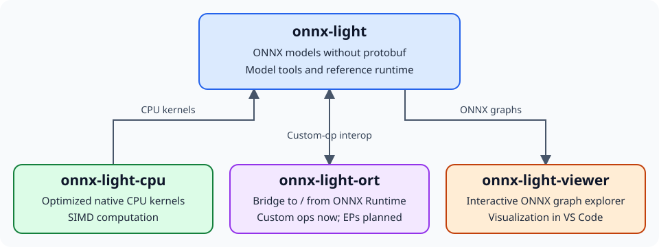

onnx-light-ort
==============

.. image:: https://github.com/xadupre/onnx-light-ort/actions/workflows/docs.yml/badge.svg?branch=main
   :target: https://github.com/xadupre/onnx-light-ort/actions/workflows/docs.yml
   :alt: Documentation build status

.. image:: https://codecov.io/gh/xadupre/onnx-light-ort/branch/main/graph/badge.svg
   :target: https://codecov.io/gh/xadupre/onnx-light-ort
   :alt: Native C++ code coverage

Interoperability between onnx-light and ONNX Runtime custom operators and
execution providers, in both directions.

.. toctree::
   :maxdepth: 1

   introduction
   components/index
   auto_examples/index
   newt_steps/index
